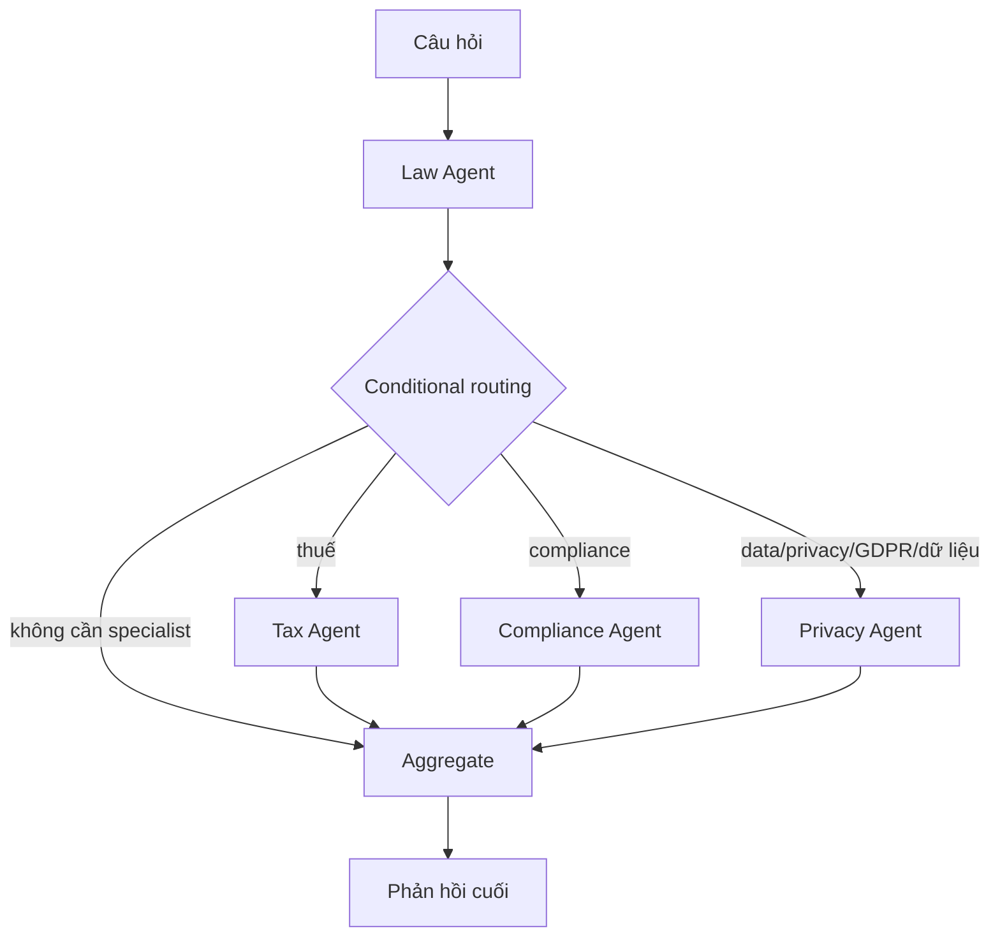
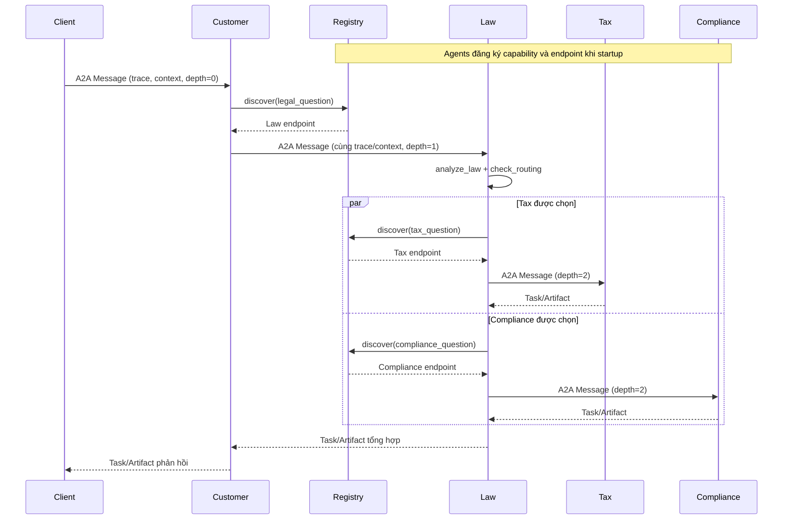

# Báo cáo codelab Day 9 — Multi-Agent / A2A

Phạm vi: toàn bộ yêu cầu chính 1.1–5.3 và hai exercise; căn cứ nguồn ghi tại [SOURCE.md](SOURCE.md). Lệnh chạy và cài đặt: [HUONG-DAN.md](HUONG-DAN.md).

**Trạng thái: đã triển khai code, 61 test offline đạt và đã chạy demo với Gemini thật.** Sáu entry point Stage 1–4/exercises đạt; bốn kiểm tra A2A thực tế đạt, gồm trace, Tax shutdown, đổi cổng/rediscovery và so sánh prompt. Bằng chứng: [reports/LIVE-RESULTS.md](reports/LIVE-RESULTS.md). Provider Gemini trực tiếp được dùng theo yêu cầu của người dùng, thay cho OpenRouter trong codelab. Link đề gốc không truy cập được nên chưa xác nhận bản công khai đồng nhất với đề gốc; bộ test bổ sung không phải bộ chấm chính thức.

## Đối chiếu yêu cầu

| Bài | Kết quả / vị trí | Bằng chứng |
| --- | --- | --- |
| 1.1 | Stage 1 dùng câu hỏi tiếng Việt về công ty trốn thuế | Gemini thật: `reports/live-outputs/stage1.txt` |
| 1.2 | `common/llm.py`: temperature mặc định 0.3, có thể truyền tham số | Test cấu hình 0.3 và 0.1 không gọi mạng |
| 2.1 | Entry `labor_law` trong Stage 2 và exercise 2 | Test “sa thải”, “HỢP ĐỒNG LAO ĐỘNG” |
| 2.2 | `check_statute_of_limitations` đăng ký trong tools | Test 3 loại vụ việc/loại lạ và Gemini thật: `live-outputs/exercise2.txt` |
| 3.1 | `search_case_law` trong danh sách TOOLS Stage 3 | Test 3 nhóm án lệ; Gemini thật chọn tool: `reports/live-outputs/stage3.txt` |
| 3.2 | `debug=True` và stream node/tool events ở Stage 3 | Test entry point chạy hết; không dùng tham số `verbose` sai API |
| 4.1 | Privacy Agent, state và aggregation trong Stage 4 / exercise 4 | Test giữ đủ kết quả Tax, Compliance và Privacy |
| 4.2 | Conditional routing theo từ khóa, dùng `Send` | Test chỉ Privacy, đủ 3 nhánh, và không cần specialist |
| 5.1 | A2A trace qua Customer → Law → Tax/Compliance | `reports/live-a2a.json`: 5 process thật, Gemini thật, đúng trace/context/depth |
| 5.2 | Tax dừng: vẫn có Compliance; Tax chạy lại ở cổng mới | `reports/live-a2a.json`: shutdown và rediscovery thực tế đạt |
| 5.3 | Prompt Tax dưới 150 từ, tối đa 4 bullet | Gemini thật: prompt gốc 690 từ → prompt sửa 145 từ, 4 bullet |

## Stage 1 — Direct LLM

`get_llm()` tạo `ChatOpenAI`; provider gốc OpenRouter dùng `OPENROUTER_MODEL` và `OPENROUTER_API_KEY`. Theo yêu cầu tiếp theo của người dùng, đã thêm provider Gemini trực tiếp dùng `GEMINI_MODEL` và `GEMINI_API_KEY`/`GOOGLE_API_KEY`, chọn bởi `LLM_PROVIDER`. Đây là thay đổi provider so với codelab. Temperature thấp giúp giảm độ biến thiên nhưng không bảo đảm câu trả lời đúng hoặc hoàn toàn xác định.

Input gồm `SystemMessage` quy định vai trò/cách trả lời và `HumanMessage` chứa câu hỏi. Phân biệt hai loại message giúp giữ hướng dẫn ở đúng vai trò. Stage 1 không có retrieval, tools hoặc lưu hội thoại giữa các lần gọi; câu trả lời phụ thuộc kiến thức model.

## Stage 2 — RAG và tools

Kho tri thức mẫu là list các dict `{id, keywords, text}`. `@tool` cung cấp mô tả và schema tham số để model có thể chọn hàm. `bind_tools(TOOLS)` đưa schema vào request; nó không tự chạy hàm Python.

Luồng thủ công: gọi LLM → nhận `tool_calls` → tra `tool_map` → `ainvoke(args)` → thêm `ToolMessage` đúng `tool_call_id` → gọi LLM lần nữa để tổng hợp. Đây là một lượt gọi tool thủ công, chưa phải vòng lặp tự chủ như Stage 3.

Entry lao động có các từ khóa nhiều từ. Cách cũ lấy giao giữa các từ đơn với chuỗi `"lao động"` không tìm được cụm này. Bài làm dùng phrase matching và `casefold()` để tìm được câu hỏi tiếng Việt, kể cả chữ hoa.

Tool thời hiệu giữ bảng ví dụ của codelab cho `contract`, `tort`, `property`, chuẩn hóa khoảng trắng/chữ hoa và trả “Không xác định” cho loại khác. Bảng này không nhận jurisdiction, ngày phát sinh tranh chấp hoặc các ngoại lệ; không được dùng để suy ra thời hiệu cho hợp đồng lao động Việt Nam thực tế.

## Stage 3 — Single Agent / ReAct

`create_react_agent` tự điều phối chu kỳ model → tools → model cho đến khi có phản hồi cuối hoặc chạm giới hạn graph. Khác Stage 2, chương trình không tự viết từng lượt gọi tool. `search_case_law` cung cấp các ví dụ theo từ khóa breach, negligence, contract; không có từ khóa thì báo không tìm thấy.

Đề ghi `verbose=True`, nhưng API đang dùng nhận `debug=True`. Đã bật debug trong code và ghi cách chạy tại `HUONG-DAN.md`; file đề `CODELAB.md` giữ nguyên nội dung nguồn. Stream `updates` hiển thị node, tên tool, arguments, kết quả tool và câu trả lời cuối. Đây là sự kiện thực thi quan sát được, không phải suy nghĩ nội bộ của model.

Test ReAct xác nhận có `ToolMessage` chứa án lệ Hadley và có `AIMessage` cuối không còn tool call. Phiên Gemini thật trong `reports/live-outputs/stage3.txt` cũng đã chọn `search_case_law`. Khi kiểm tra thật, phát hiện adapter LangChain cũ bỏ trường `extra_content.google.thought_signature` ở lượt tiếp theo; đã thêm `GeminiChatOpenAI` giữ nguyên metadata do Google trả về và test hồi quy cho lượt tool-result. Không tạo hoặc giả mạo signature.

## Stage 4 — Multi-Agent trong cùng process

`TypedDict` mô tả state; mỗi node trả dict cập nhật trường tương ứng. Router trả list `Send` để chọn các specialist cần thiết. Các node specialist nhận câu hỏi và phân tích Law; aggregator nhận những trường kết quả có nội dung để ghép thành báo cáo.

Trong exercise 4 bản cơ sở, `check_routing` trả list `Send` nhưng được đăng ký bằng `add_node`. Node phải cập nhật state bằng dict, nên cách nối này làm graph lỗi. Đã gắn `check_routing` trực tiếp bằng `add_conditional_edges("law_agent", ...)`.

Test không chỉ đo thời gian: ba specialist cùng chờ một barrier. Barrier chỉ mở khi đủ ba nhánh bắt đầu; chạy tuần tự sẽ timeout. Test khác stream từng update và xác nhận aggregator chạy đúng một lần, có đủ kết quả được chọn, không xuất hiện kết quả của specialist không được route.

Stage 4 dùng thêm reducer cho các trường kết quả và giữ topology fan-out/fan-in. Sơ đồ graph thực tế sinh từ code nằm trong `docs/privacy-graph.mmd`.

Lần rà soát tiếp theo phát hiện Stage 4 kế thừa một fallback cho phép LLM quyết định lại routing khi không khớp từ khóa. Đã bỏ fallback để tuân thủ chính xác bài 4.2: chỉ route Privacy khi có `data`, `privacy`, `gdpr` hoặc `dữ liệu`; không khớp thì tổng hợp trực tiếp. Đã bổ sung test hồi quy cho điều kiện này.

## Stage 5 — Distributed A2A

Mỗi agent là HTTP service riêng, có Agent Card mô tả skills. Registry hỗ trợ `/register`, `/discover/{task}`, `/agents`, `/health`. Khi cần delegation, caller tra task để lấy endpoint rồi đọc Agent Card và gửi A2A message. URL Registry được cấu hình; endpoint specialist không được hardcode trong logic gọi.

`trace_id` và `context_id` được truyền trong metadata; `context_id` cũng nằm ở Message. `task_id` là định danh công việc riêng tại mỗi agent. Depth tăng mỗi hop: Customer 0 → Law 1 → Tax/Compliance 2. Law dừng gọi specialist khi depth ≥ 3; Customer và delegation helper cũng chặn quá giới hạn.

Client dùng đường dẫn Agent Card của SDK 0.3.26 và giữ fallback cho đường dẫn cũ. Khi response có JSON-RPC error hoặc Task trạng thái failed/canceled/rejected, helper báo lỗi; không coi câu hỏi trong Task.history là câu trả lời thành công.

Routing Law dùng LLM trả JSON; đã kiểm tra kiểu boolean thực. Giá trị `"false"` là chuỗi không còn bị chuyển nhầm thành `True` bằng `bool("false")`. JSON sai cấu trúc hoặc không parse được quay về chính sách gọi cả hai specialist của starter; có log cảnh báo.

### Quan sát Tax Agent dừng và phục hồi

Test khởi động Registry và 4 agent thành 5 process riêng, kiểm tra Agent Card qua TCP, rồi gửi câu hỏi qua Customer bằng client A2A thật.

Khi dừng Tax process, Registry vẫn trả endpoint cũ do chỉ lưu đăng ký trong bộ nhớ. Law bắt lỗi kết nối và tạo mục `Tax analysis unavailable`; kết quả Compliance vẫn được ghép. Điều này cho thấy discovery không tự phát hiện service chết. Muốn vận hành lâu dài cần heartbeat/TTL hoặc health check; đó chưa phải tính năng đã triển khai.

Test khởi động Tax ở một cổng trống khác. Đăng ký cùng agent_name cập nhật endpoint. Request kế tiếp đi qua Registry và nhận được kết quả Tax; không còn mục unavailable. Endpoint cũ/mới và câu trả lời hai lần nằm trong `reports/a2a-evidence.json`.

### Hành vi Tax Agent

Prompt được sửa theo 5.3: dưới 150 từ, tối đa 4 bullet, nêu thiếu jurisdiction hoặc dữ kiện. Phiên Gemini thật so sánh cùng câu hỏi: prompt gốc trả 690 từ; Tax Agent chạy prompt đã sửa trả 145 từ và 4 bullet. Đây là quan sát trong phiên chạy, không bảo đảm mọi câu hỏi tương lai đều đạt giới hạn; ứng dụng chưa có validator cắt/sửa output sau generation.

## Trả lời câu hỏi tổng kết

1. **Khi nào chọn single agent?** Khi phạm vi nhỏ, các tool liên quan chặt, không cần scale từng chuyên gia hoặc phân quyền độc lập. Multi-agent thêm nhiều lời gọi model, chi phí, thời gian và lỗi truyền thông; chỉ dùng khi sự chuyên môn hóa hoặc phân tán có ích.
2. **A2A hơn REST/gRPC thông thường ở đâu?** REST/gRPC là cách thiết kế/truyền RPC; A2A bổ sung quy ước Agent Card, capability, Message, Task, Artifact và vòng đời tương tác agent. A2A vẫn có thể dùng HTTP/JSON-RPC; không tự bảo đảm chất lượng, bảo mật hay fault tolerance.
3. **Ngăn delegation vô hạn?** Truyền depth, tăng khi gọi, kiểm tra giới hạn ở caller; giới hạn số bước ReAct và timeout. Bản này có depth guard ở Customer, Law và helper, cùng timeout LLM/HTTP. Không có circuit breaker hoặc tự retry mọi tác vụ A2A.
4. **Vì sao Registry? Có hardcode URL được không?** Registry ánh xạ task sang endpoint, giúp thay cổng/service mà không sửa caller. Hardcode được trong demo nhỏ nhưng tăng coupling và khiến thay endpoint phải sửa nhiều nơi. Registry hiện tại chỉ là in-memory discovery, chưa có độ sẵn sàng cao hoặc xác thực đăng ký.
5. **MCP và A2A khác nhau thế nào?** MCP dùng để kết nối model/agent với tool và tài nguyên của server; A2A chuẩn hóa giao tiếp, capability và task giữa các agent. Codelab này dùng tools LangChain trong process và A2A giữa service; không có yêu cầu chính nào triển khai MCP server riêng trong tài liệu truy cập được.

## Kết quả kiểm tra và giới hạn

**61 passed**, Python 3.13.17; bằng chứng đầy đủ ở `reports/`. `pip check` không có dependency hỏng. Bộ test gồm cấu hình model, tools/retrieval tiếng Việt, ReAct, routing, song song, aggregation, lỗi JSON, depth guard, Registry, A2A và Tax shutdown/recovery.

Bộ 61 test dùng fixture/HTTP mock để kiểm tra hồi quy. Ngoài ra đã có phiên LLM thật độc lập: `gemini-connection.json`, `live-codelab.json`, `live-outputs/*.txt` và `live-a2a.json`; các script live không chèn model fixture. Chưa đánh giá độ chính xác pháp luật bằng bộ ground truth hoặc chấm chi phí token toàn pipeline. Hai cảnh báo thư viện còn lại là plugin AnyIO với pytest 9.2 và `A2AClient` legacy; client được giữ để phù hợp skeleton SDK 0.3.26 đã kiểm thử.

Các challenge tự học memory, API-key authentication cho endpoint, retry A2A có backoff và monitoring không thuộc phần đã hoàn thành. Đã có retry cấu hình của client LLM và retry đăng ký từ starter; chúng không tương đương những challenge trên.
